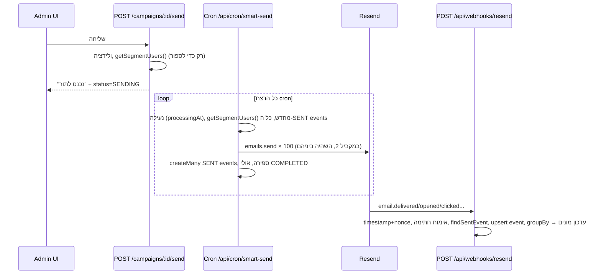

# מערכת דיוור — ניתוח MyNeto ותוכנית מימוש

> מסמך 2 מתוך 2. רקע כללי, stack ותפעול נמצאים ב-[`01-GENERAL-PLAN.md`](./01-GENERAL-PLAN.md).
> מקור הניתוח: `~/Desktop/FinanceManager.nosync` (ה-repo הפעיל, commit מ-18.10.2026). התיקייה `~/Desktop/FinanceManager` היא עותק ישן ממרץ.
> עודכן: 18.10.2026
>
> **Scope update:** Current sending is `/send`: upload a CSV, send through Resend, store nothing. No subscribers, no campaign records, no unsubscribe database. The design below is the later version.

---

## 0. תקציר

- **מה מעתיקים:** קמפיינים חד-פעמיים (יצירה, עריכה, תצוגה מקדימה, מייל בדיקה, שליחה, דוח), קהלים וקבוצות, ייבוא CSV, הסרה בלחיצה אחת עם טוקן HMAC, webhook של Resend לסטטיסטיקות.
- **מה לא מעתיקים** (לפי הבקשה, ומה שתלוי בהם): workflows, email-sequences, templates, crons, smart-send לפי שעת פתיחה, תזמון, A/B עם בחירת מנצח אוטומטית, inbox, funnel, reactivation.
- **השינוי המרכזי:** ב-MyNeto השליחה בפועל מתבצעת **ב-cron** (`/api/cron/smart-send`, 100 נמענים בכל הרצה). בלי crons, השליחה כאן רצה ב-`after()` של Next.js בתוך אותה בקשה, עם **צילום קהל** (טבלת `CampaignRecipient`), **Resend Batch API** (100 מיילים בקריאה), ו-**idempotency keys**. כך היא מהירה, בטוחה לקריסות, וניתנת להמשך.
- **בדרך תוקנו 19 בעיות** שמצאתי בקוד של MyNeto, כולל שני באגים חמורים: נמענים חיצוניים מ-CSV **אף פעם לא נשלחים**, ושם המשתמש מוזרק ל-HTML של המייל **בלי escaping**. פירוט בסעיף 3.

---

## 1. איך מערכת הדיוור של MyNeto בנויה

### 1.1 מפת קבצים (רק החלקים הרלוונטיים)

| שכבה | קובץ | שורות | תפקיד |
|---|---|---|---|
| DB | `prisma/schema.prisma` שורות 1087–1185 | | `MarketingCampaign`, `MarketingEvent`, `EmailTemplate`, enums |
| DB | `prisma/schema.prisma` שורות 39–40 | | `User.isMarketingSubscribed`, `User.marketingUnsubscribedAt` |
| Lib | `src/lib/marketing/resend.ts` | 340 | עטיפת Resend: שליחה בודדת, "batch" (בפועל לולאה), מייל בדיקה, הוספת קישור הסרה וכותרות |
| Lib | `src/lib/marketing/segment.ts` | 440 | המרת `SegmentFilter` לרשימת משתמשים/ספירה + ולידציה ידנית |
| Lib | `src/lib/marketing/unsubscribeToken.ts` | 138 | טוקני HMAC v1/v2 לפי userId ולפי email |
| Lib | `src/lib/marketingGroups.ts` | 335 | קבוצות מערכת קבועות (פעילים / לא פעילים / ...) וסנכרון לפי העדפות |
| Lib | `src/lib/inbox/constants.ts` | | `SENDER_ADDRESSES`, `isValidSenderAddress`, `getSenderDisplay` |
| Lib | `src/lib/webhookSecurity.ts` | | בדיקת timestamp + nonce ב-Upstash נגד replay |
| API | `api/admin/marketing/campaigns/route.ts` | 163 | `GET` רשימה + מונים, `POST` יצירה |
| API | `api/admin/marketing/campaigns/[id]/route.ts` | 247 | `GET`/`PUT`/`DELETE` |
| API | `api/admin/marketing/campaigns/[id]/send/route.ts` | 213 | ולידציה ומעבר ל-`SENDING`/`TESTING`/`SMART_QUEUED`. **לא שולח בפועל.** |
| API | `api/cron/smart-send/route.ts` | 282 | **השולח האמיתי.** רץ ב-cron, נועל קמפיין, שולח 100, רושם `SENT` |
| API | `api/admin/marketing/campaigns/[id]/sync/route.ts` | 209 | שליפת `last_event` מ-Resend לכל מייל (עוקף webhooks בלוקאל) |
| API | `api/admin/marketing/campaigns/[id]/report/*` | 216+77+120 | מדדים, קישורים, פעילות לפי נמען |
| API | `api/admin/marketing/campaigns/preview`, `[id]/preview`, `test-email` | | תצוגה מקדימה ומייל בדיקה |
| API | `api/webhooks/resend/route.ts` | 352 | קליטת אירועי Resend, עדכון מונים, למידת שעת פתיחה |
| API | `api/marketing/unsubscribe/route.ts`, `unsubscribe-email/route.ts` | 202+253 | הסרה (GET ו-POST, כולל RFC 8058) |
| UI | `app/admin/marketing/campaigns/new/page.tsx` | 1263 | אשף בשלושה שלבים: הגדרות וקהל ← תוכן ← סקירה ושליחה |
| UI | `app/admin/marketing/campaigns/[id]/edit/page.tsx`, `[id]/page.tsx`, `page.tsx` | 782+479+415 | עריכה, פרטים, רשימה |
| UI | `components/admin/marketing/reports/CampaignReportDashboard.tsx` + טבלאות | 475+150+175 | דוח קמפיין |
| UI | `components/admin/EmailPreview.tsx` | 109 | תצוגה מקדימה ב-iframe מבודד עם CSP |
| UI | `SegmentSelector`, `GroupOnlyAudienceSelector`, `UserSelector`, `CsvUploader` | | בחירת קהל |

### 1.2 מודל נתונים

```text
User ──< MarketingEvent >── MarketingCampaign
 │  isMarketingSubscribed           status: DRAFT|SCHEDULED|SENDING|SMART_QUEUED|TESTING|COMPLETED|CANCELLED
 │  preferredSendHour               segmentFilter: Json   (הקהל מחושב מחדש בכל הרצה)
 │  openHoursLog[]                  sentCount/openCount/... (מונים מוכפלים)
 └──< UserGroupMember >── UserGroup processingAt (נעילה של cron)

MarketingEvent: (campaignId?, workflowId?, userId, emailId, eventType, metadata)
  @@unique([emailId, eventType])                        ← אירוע אחד מכל סוג לכל מייל
  @@unique([campaignId, userId, eventType])
```

**נקודה מהותית:** אין "רשימת נמענים" לקמפיין. כל הרצת cron מריצה `getSegmentUsers()` מחדש, טוענת **את כל** אירועי ה-`SENT` של הקמפיין, ומחשבת "מי עוד לא קיבל". הנמען מזוהה תמיד דרך `User`, ולכן נמען חיצוני מ-CSV מקבל ID מזויף `external-<email>`.

### 1.3 זרימת שליחה (כמו שהיא היום)



### 1.4 רכיב אחר רכיב

**`resend.ts`**
- Singleton עצל של `Resend`.
- `addUnsubscribeLink()` מוסיף לפני `</body>` בלוק עם קישור הסרה. למשתמש: `buildUnsubscribeUrl(userId)`, לחיצוני: `buildEmailUnsubscribeUrl(email)`.
- `unsubscribeHeaders()` מוסיף `List-Unsubscribe: <url>` ו-`List-Unsubscribe-Post: List-Unsubscribe=One-Click` (RFC 8058, נדרש ע"י Gmail ו-Yahoo). **שווה להעתיק.**
- `sendBatchEmails()` היא **לא** Batch API. זו לולאה של `emails.send` בודדים, עם concurrency 2 והשהיה מחושבת ("spread"). Retry על 429 מזוהה לפי **התאמת מחרוזת** בהודעת השגיאה.
- Tags: `campaign_id`, `user_id`, `type`, `variant_id`.

**`segment.ts`**
- `SegmentFilter.type` יכול להיות: `all | freeOnly | inactiveDays | hasProfile | noTransactionsThisMonth | haredi | manual | csv | custom | group | activeUsers`. רובם ספציפיים לאפליקציה פיננסית.
- הלוגיקה **משוכפלת** בין `getSegmentUsers` ל-`countSegmentUsers`.
- `custom` ממזג `Prisma.UserWhereInput` גולמי שמגיע מהלקוח.
- ולידציה ידנית ארוכה במקום סכמה.

**`unsubscribeToken.ts`** (**שווה להעתיק, עם שינויים**)
- פורמט v2: `v2.<expiryEpochSec>.<hex>`, HMAC-SHA256 על `userId:expiry`, תפוגה של 90 יום, `timingSafeEqual`, תוצאה מובנית (`malformed`/`expired`/`mismatch`).
- גרסה לפי email לנמענים חיצוניים.
- חותם עם `NEXTAUTH_SECRET` (שימוש חוזר בסוד).

**`send/route.ts`**
- בודק שהסטטוס לא `SENDING`/`COMPLETED`, ש-API key קיים, שהפילטר תקין, ושיש לפחות נמען אחד, ואז מעדכן סטטוס. מסלולי A/B ו-smart נפרדים.
- המעבר לא אטומי (`findUnique` ואחריו `update`), כך שלחיצה כפולה יכולה לעבור.

**`cron/smart-send/route.ts`**
- מקדם `SCHEDULED` ל-`SENDING` כשמגיע הזמן (לא בשבת).
- נעילה אטומית: `updateMany where processingAt is null OR stale(5min)`. **דפוס טוב, מועתק.**
- שולח 100 בכל הרצה, רושם `SENT` עם `createMany skipDuplicates`, וסוגר ל-`COMPLETED` כש-`sent >= eligible`.
- החלפת `[שם המשתמש]` ב-`user.name` בנושא וב-HTML.

**`webhooks/resend/route.ts`**
- `validateWebhookSecurity` (timestamp ו-nonce ב-Upstash), ואז `resend.webhooks.verify` על raw body.
- מתעלם מ-`email.sent` (נרשם כבר בשליחה).
- מוצא את אירוע ה-`SENT` לפי `emailId`. אם אין, מחזיר 200.
- Upsert לאירוע (`findFirst` ואז `update`/`create`), ומריץ `syncCampaignStats` (`groupBy`) **על כל אירוע**.
- למידת שעת פתיחה מועדפת (ממוצע מעגלי), בשביל smart-send. לא רלוונטי לנו.

**`sync/route.ts`**
- לכל מייל שנשלח: `resend.emails.get(id)`, ולפי `last_event` "ממציא" אירועים משתמעים עם `timestamp: new Date()`. נועד ללוקאל, שבו webhooks לא מגיעים.

**`report/route.ts`**
- ספירת ייחודיים לפי `emailId`: opens, clicks, unsubscribes, complaints, ו-bounces hard/soft לפי `bounceType === 'Permanent'`. אחוזים מתוך `sentCount`. CTOR = clicks/opens. ציר זמן של 24 שעות מ-`startedAt`. פירוק A/B.

**`unsubscribe/route.ts`**
- `GET` עם טוקן תקין **מבצע הסרה מיד** ומחזיר HTML.
- `POST` תומך ב-RFC 8058 (form `List-Unsubscribe=One-Click`, ומחזיר 200 ריק) ובטופס legacy.
- Rate limit לפי IP. לא חושף אם המשתמש קיים.
- `moveUnsubscribedToInactive` מעביר בין קבוצות מערכת.

**UI**
- אשף בשלושה שלבים: (1) שם, שולח וקהל; (2) תוכן כ-**HTML גולמי ב-textarea**, עם עורך מורחב במודאל ותצוגה מקדימה חיה; (3) סקירה, מייל בדיקה ושליחה.
- `EmailPreview` מרנדר ב-iframe עם `sandbox` בלי `allow-scripts` ומזריק CSP `default-src 'none'`. **דפוס טוב, מועתק.**
- `RichTextEditor` (TipTap) משמש ב-inbox, לא בקמפיינים.

---

## 2. מה מעתיקים, מה מתאימים, ומה מוותרים

| רכיב ב-MyNeto | החלטה | הערה |
|---|---|---|
| טוקן HMAC v2 עם תפוגה | ✅ מעתיקים | סוד ייעודי `UNSUBSCRIBE_SECRET`; הטוקן חותם על `recipientId` (ולא על userId), כדי לייחס הסרה לקמפיין |
| כותרות `List-Unsubscribe` + One-Click | ✅ מעתיקים | |
| POST של RFC 8058 | ✅ מעתיקים | |
| GET שמבצע הסרה מיד | 🔁 משנים | GET מציג דף אישור עם כפתור, POST מבצע (מגן מסורקי קישורים) |
| נעילה אטומית `updateMany` + stale | ✅ מעתיקים | נקראת `lockedAt`, ומתחדשת בכל batch |
| אימות webhook עם `resend.webhooks.verify` | ✅ מעתיקים | **לפני** כל דבר אחר; idempotency ב-DB לפי `svix-id`, בלי Upstash |
| מדדי דוח (unique opens, CTOR, hard/soft bounce) | ✅ מעתיקים | ספירה ייחודית לפי `recipientId`, מתוך SQL |
| iframe מבודד + CSP לתצוגה מקדימה | ✅ מעתיקים | |
| אשף בשלושה שלבים | ✅ מעתיקים | |
| רשימת שולחים מותרים | ✅ מעתיקים | `src/lib/mailing/senders.ts` (כבר קיים) |
| `SegmentFilter` עם 11 סוגים | 🔁 מצמצמים | `all` / `groups` (include + exclude) / `subscribers`. CSV הופך לייבוא נמענים לקבוצה, ולא לסוג קהל |
| `custom` (Prisma where מהלקוח) | ❌ מוותרים | סיכון אבטחה |
| `User` כנמען + `external-*` | 🔁 משנים | מודל `Subscriber` נפרד |
| קבוצות מערכת קבועות + `syncUserMailingGroups` | ❌ מוותרים | סטטוס על `Subscriber` מחליף אותן; קבוצות כאן הן ידניות בלבד |
| שליחה ב-cron | 🔁 משנים | `after()` + צילום קהל + Batch API |
| `sendBatchEmails` (לולאה בודדת) | 🔁 משנים | `resend.batch.send` עם 100 בקריאה |
| מונים מוכפלים ו-`syncCampaignStats` בכל webhook | ❌ מוותרים | מונים מחושבים בדוח; רק `sentCount`/`failedCount` נשמרים |
| `sync` מ-Resend API | ❌ מוותרים (אופציונלי בהמשך) | בלוקאל משתמשים ב-tunnel ל-webhook; ה-sync מייצר timestamps שגויים |
| smart-send, תזמון, A/B אוטומטי, למידת שעות | ❌ מוותרים | כולם תלויים ב-cron |
| templates, workflows, sequences, inbox, funnel | ❌ מוותרים | לפי הבקשה |

---

## 3. בעיות שמצאתי ב-MyNeto (ולא מעתיקים)

| # | חומרה | בעיה | איפה |
|---|---|---|---|
| 1 | 🔴 | **נמענים חיצוניים מ-CSV אף פעם לא נשלחים.** ה-cron מסנן `!u.id.startsWith('external-')`, אבל ה-send route סופר אותם ומודיע "X נמענים". גם הסגירה ל-`COMPLETED` לא סופרת אותם. | `cron/smart-send/route.ts:154-156, 174-175, 265`; `send/route.ts:107, 190` |
| 2 | 🔴 | **HTML injection במייל:** `[שם המשתמש]` מוחלף ב-`user.name`, שהמשתמש עצמו קובע, **בלי escaping**. משתמש עם שם כמו `<a href=evil>` מזריק HTML למייל שלו (ובבדיקה, למייל של האדמין). | `cron/smart-send/route.ts:207-218`; `test-email/route.ts:43-45` |
| 3 | 🟠 | אין sanitization בצד השרת לתוכן הקמפיין. | `campaigns/route.ts:101-139`, `[id]/route.ts` |
| 4 | 🟠 | `PUT` מקבל `status` שרירותי מגוף הבקשה, ומאפשר לדלג על מכונת המצבים (למשל לסמן `COMPLETED` ידנית). | `campaigns/[id]/route.ts:112, 167` |
| 5 | 🟠 | `GET` להסרה מבצע את ההסרה, כך שסורקי קישורים (Outlook SafeLinks, שערי אבטחה ארגוניים) מסירים נמענים בלי כוונה. | `unsubscribe/route.ts:143-161` |
| 6 | 🟠 | Nonce נבדק ונשמר **לפני** אימות החתימה, כך שבקשות לא חתומות "שורפות" nonces וממלאות את Redis. | `webhooks/resend/route.ts:220-236` |
| 7 | 🟠 | אין idempotency keys. קריסה בין קבלה ב-Resend ל-`createMany` גורמת לשליחה כפולה בהרצה הבאה. | `cron/smart-send/route.ts:224-257` |
| 8 | 🟡 | `@@unique([emailId, eventType])` שומר רק קליק **אחד** לכל מייל, וקליקים נוספים רק מעדכנים timestamp. דוח הקישורים מאבד קליקים על קישורים אחרים. | `schema.prisma:1159`; `webhooks/resend/route.ts:300-312` |
| 9 | 🟡 | Resend שולח `tags` כ-**אובייקט** (`Record<string,string>`), אבל הקוד מצפה למערך, כך שה-fallback של `variant_id` אף פעם לא עובד. | `webhooks/resend/route.ts:35, 274-278` |
| 10 | 🟡 | כל הרצת cron טוענת מחדש את **כל** הקהל ואת **כל** אירועי ה-SENT. סיבוכיות O(N²/100), והקהל "זז" באמצע שליחה. | `cron/smart-send/route.ts:145-156` |
| 11 | 🟡 | `sendBatchEmails` שולח אחד-אחד במקום Batch API, ולכן קצב של בערך 100 מיילים לדקה בכל הרצה. | `resend.ts:259-304` |
| 12 | 🟡 | זיהוי 429 לפי התאמת מחרוזת בהודעה. | `resend.ts:226, 239` |
| 13 | 🟡 | `syncCampaignStats` (`groupBy` מלא) רץ על **כל** webhook (write amplification). | `webhooks/resend/route.ts:336-338` |
| 14 | 🟡 | `sync` מייצר אירועים עם `timestamp: new Date()`, כך שציר הזמן בדוח מעוות; בנוסף, N+1 שאילתות. | `sync/route.ts:115-145` |
| 15 | 🟡 | לוגיקת הסגמנט משוכפלת בין `get` ל-`count`, והן יכולות להתפצל. `custom` מקבל Prisma where מהלקוח. | `segment.ts:28-258, 263-358` |
| 16 | 🟡 | מעבר `DRAFT`→`SENDING` לא אטומי, כך שלחיצה כפולה יכולה לעבור. | `send/route.ts:37-61, 173-181` |
| 17 | 🟡 | `test-email` לא מוודא את `to`. כל אדמין יכול לשלוח לכל כתובת מהדומיין. | `test-email/route.ts:26-33` |
| 18 | ⚪ | סוד ה-auth משמש גם לטוקני הסרה. | `unsubscribeToken.ts:35` |
| 19 | ⚪ | אין קידומת "פרסומת" ואין footer עם זיהוי שולח, כפי שנדרש בחוק התקשורת סעיף 30א. | — |

---

## 4. התכנון החדש

### 4.1 מודל נתונים

כבר נמצא ב-`prisma/schema.prisma`. עיקרי ההחלטות:

| מודל | שדות מרכזיים | למה |
|---|---|---|
| `Subscriber` | `email @unique` (lowercase), `status`, `source`, `consentAt`, `consentSource`, `unsubscribedAt` | ישות אחת לכל נמען, כולל מ-CSV. סטטוס אחד במקום בוליאני ושלוש קבוצות מערכת. |
| `Group` / `GroupMember` | PK מורכב `(groupId, subscriberId)` | קבוצות ידניות; idempotent מטבען. |
| `Campaign` | `contentHtml`, `fromEmail`, `audience` (Json), `status`, `totalRecipients`, `sentCount`, `failedCount`, `lockedAt` | בלי מוני open/click מוכפלים; הם מחושבים. |
| `CampaignRecipient` | `@@unique([campaignId, subscriberId])`, `status`, `resendEmailId @unique`, `error`, `sentAt` | **צילום קהל.** בסיס להמשך שליחה, idempotency, ודוח לפי נמען. |
| `EmailEvent` | `webhookId @unique`, `type`, `link`, `occurredAt` | כל אירוע נשמר (כולל קליקים מרובים), ו-retry של webhook לא מכפיל. |

**מכונת מצבים של קמפיין:**

```text
DRAFT ──send──▶ SENDING ──(אין PENDING)──▶ COMPLETED
  │                │
  │                ├──cancel──▶ CANCELLED
  │                └──(שגיאה בלתי הפיכה, למשל דומיין לא מאומת)──▶ FAILED
  └──delete (רק DRAFT)
```

- עריכה מותרת רק ב-`DRAFT`.
- כל מעבר מתבצע עם `updateMany({ where: { id, status: <expected> } })` ובדיקה ש-`count === 1`, כך שהוא אטומי ומונע לחיצה כפולה.
- `status` **אף פעם** לא מתקבל מהלקוח.

### 4.2 קהל (`AudienceFilter`)

```ts
// src/lib/mailing/audience.ts (שלב 4)
const audienceSchema = z.discriminatedUnion("type", [
  z.object({ type: z.literal("all") }),
  z.object({
    type: z.literal("groups"),
    include: z.array(z.cuid()).min(1),
    exclude: z.array(z.cuid()).default([]),
  }),
  z.object({ type: z.literal("subscribers"), ids: z.array(z.cuid()).min(1).max(5000) }),
]);
```

- **פונקציה אחת** בונה `Prisma.SubscriberWhereInput` מהפילטר, ו-`count` ו-`findMany` שתיהן משתמשות בה. זה מונע את השכפול של בעיה 15.
- `status: "ACTIVE"` מתווסף **תמיד** בתוך הפונקציה, ולא ניתן לעקיפה.
- `switch` ממצה על `type` עם `never` ב-default.

**ייבוא CSV** הוא פעולה נפרדת:
1. העלאה ופענוח בצד הלקוח (קובץ קטן), ושליחת מערך לשרת דרך Server Action.
2. בשרת: zod (`z.email()`), lowercase ו-trim, הסרת כפולים, ומגבלה של 10,000 שורות לייבוא.
3. checkbox חובה: "לכל הנמענים ברשימה יש הסכמה מפורשת לקבל דיוור", ושדה `consentSource` חובה (למשל "טופס הרשמה לאירוע פתיחת שנה").
4. `createMany skipDuplicates` לנמענים חדשים. **לא משנים סטטוס של קיימים**, כדי שנמען שהוסר לא יחזור בשקט. הוספה לקבוצה (קיימת או חדשה).
5. סיכום: נוספו X, קיימים Y, לא תקינים Z (עם רשימה), מוסרים שדולגו W.

### 4.3 מנוע השליחה (בלי cron)

#### עקרונות

1. **צילום קהל** בעת לחיצה על "שלח", לטבלת `CampaignRecipient`. הקהל קבוע מרגע זה.
2. **`after()`** מריץ את הלולאה אחרי שהתגובה חוזרת לאדמין. ב-Vercel הוא רץ עד `maxDuration` (ברירת מחדל 300 שניות ב-Fluid Compute).
3. **Batch API:** `resend.batch.send()` עם עד 100 מיילים בקריאה, וכל קריאה נספרת כבקשה אחת מתוך מגבלת 10 בקשות לשנייה של הצוות.
4. **Idempotency key** דטרמיניסטי לכל batch. אם התהליך קרס אחרי ש-Resend קיבל אבל לפני שעדכנו DB, ההרצה הבאה בוחרת את אותם 100 נמענים (הם עדיין `PENDING`), שולחת עם אותו מפתח, ו-Resend מחזיר את אותם IDs **בלי לשלוח שוב** (המפתח תקף 24 שעות).
5. **Lease** (`lockedAt`) שמתחדש בכל batch ונחשב stale אחרי 5 דקות. מונע שני שולחים במקביל.
6. **המשך שליחה:** אם עבר ה-deadline הפנימי (240 שניות) ונשארו `PENDING`, הלולאה משחררת את ה-lease. מסך הקמפיין מבצע polling כל 3 שניות, ואם `SENDING` + lease stale + יש `PENDING`, מוצג כפתור "המשך שליחה", שמפעיל את אותה פונקציה.

**חישוב קיבולת:** batch של 100 לוקח בערך 0.5–1.5 שניות (קריאת Resend ועדכון DB). ב-240 שניות זה **בערך 15,000–40,000 מיילים בהרצה אחת**, הרבה מעבר לגודל רשימה צפוי של מועדון. אם הרשימה תגדל מעבר לזה, מעבירים את הלולאה ל-Vercel Queues בלי לשנות את המודל.

#### פסאודו-קוד

```ts
// src/lib/mailing/send.ts
export async function startCampaignSend(campaignId: string, adminEmail: string) {
  // 1. מעבר אטומי
  const moved = await db().campaign.updateMany({
    where: { id: campaignId, status: "DRAFT" },
    data: { status: "SENDING", startedAt: new Date() },
  });
  if (moved.count !== 1) return { error: "הקמפיין כבר נשלח או אינו טיוטה" };

  // 2. צילום קהל (בחלקים של 1000)
  const where = audienceWhere(campaign.audience); // כולל status: ACTIVE
  // findMany({ where, select: { id, email } }) → createMany(..., skipDuplicates: true)
  // update totalRecipients
  // אם 0 נמענים: חוזרים ל-DRAFT ומחזירים שגיאה

  // 3. השליחה עצמה אחרי התגובה
  after(() => processCampaign(campaignId));
}

export async function processCampaign(campaignId: string) {
  const deadline = Date.now() + 240_000;
  if (!(await acquireLease(campaignId))) return; // updateMany where lockedAt null|stale

  try {
    while (Date.now() < deadline) {
      const campaign = await getCampaign(campaignId);
      if (campaign.status !== "SENDING") break;           // בוטל באמצע

      const batch = await db().campaignRecipient.findMany({
        where: { campaignId, status: "PENDING" },
        orderBy: { id: "asc" },
        take: 100,
        include: { subscriber: { select: { status: true, firstName: true } } },
      });
      if (batch.length === 0) { await finalize(campaignId); break; }

      // נמען שהוסר מאז הצילום → SKIPPED
      const [sendable, skipped] = partition(batch, (r) => r.subscriber.status === "ACTIVE");
      await markSkipped(skipped);

      const emails = sendable.map((r) => renderForRecipient(campaign, r)); // ראו 4.4
      const key = `campaign/${campaignId}/${sendable[0].id}-${sendable.at(-1)!.id}`;
      const res = await sendBatchWithRetry(emails, key);                   // 429 → backoff

      await applyResults(sendable, res);   // SENT + resendEmailId + sentAt, או FAILED + error
      await renewLease(campaignId);
    }
  } finally {
    await releaseLease(campaignId);
  }
}
```

#### פרטים חשובים

- **ולידציה מראש:** ה-Batch API אטומי כברירת מחדל: אם מייל אחד לא תקין, כל ה-batch נכשל. כל כתובת עוברת `z.email()` כבר בשמירה/ייבוא. `resend@6.34` תומך גם ב-`batchValidation: "permissive"`, שמחזיר `errors[{index, message}]` ושולח את השאר. **שלב 5 מתחיל בבדיקה** שמאשרת את סדר ה-`data` במצב permissive (האם `data[i]` תואם לאינדקס המקורי אחרי הסרת השגויים) לפני שמסתמכים עליו. אם לא חד-משמעי, משתמשים ב-strict, ובכשל ולידציה עוברים לשליחה בודדת לאותו batch.
- **429:** בודקים `error.statusCode === 429` / `error.name`, ולא טקסט. Backoff אקספוננציאלי (1, 2, 4 שניות) עד 3 ניסיונות, ואחר כך מסמנים את ה-batch כ-FAILED ועוברים הלאה.
- **שגיאה בלתי הפיכה** (דומיין לא מאומת, API key לא תקין): הקמפיין עובר ל-`FAILED` עם הודעה, והלולאה נעצרת.
- **ביטול:** Server Action מעביר `SENDING`→`CANCELLED`, והלולאה בודקת את הסטטוס בכל איטרציה.
- **סגירה:** `finalize` סופר `SENT`/`FAILED`/`SKIPPED` עם `groupBy` **פעם אחת**, ומעביר ל-`COMPLETED`.

### 4.4 רינדור מייל לנמען

פונקציה טהורה אחת, `renderForRecipient(campaign, recipient)`, משמשת **גם** לשליחה, **גם** לתצוגה מקדימה, **וגם** למייל בדיקה. כך מה שרואים זה מה שנשלח. ב-MyNeto יש שלושה מימושים נפרדים.

1. **פרסונליזציה:** טוקנים מוגדרים בלבד, `{{firstName}}` ו-`{{firstName|חבר/ה}}` (עם ברירת מחדל).
   - הערכים עוברים **HTML escape** (תיקון בעיה 2).
   - בנושא: טקסט נקי בלי HTML.
   - טוקן לא מוכר נדחה בשמירה, כדי שלא יישלח `{{foo}}` לנמענים.
2. **קידומת "פרסומת":** אם `campaign.isAdvertisement` (שדה שמתווסף בשלב 5), מוסיפים `פרסומת: ` לתחילת הנושא.
3. **מעטפת קבועה:** `<html dir="rtl" lang="he">`, preheader נסתר מ-`previewText`, ה-HTML של הקמפיין, ואז **footer** עם שם המועדון, כתובת וקישור הסרה. זו לא "מערכת templates", זה מבנה קבוע אחד בקוד.
4. **קישור הסרה:** `${APP_URL}/unsubscribe?r=<recipientId>&t=<token>`.
5. **Headers:** `List-Unsubscribe: <${APP_URL}/api/unsubscribe?r=..&t=..>` ו-`List-Unsubscribe-Post: List-Unsubscribe=One-Click`.
6. **Tags:** `campaign_id`, `recipient_id`. התאמת אירועים נעשית לפי `resendEmailId`, וה-tags משמשים גיבוי ודיבאג.
7. **From** מתוך `senderDisplay(campaign.fromEmail)` בלבד (allowlist), ו-`replyTo` אופציונלי.

### 4.5 Webhook של Resend

`POST /api/webhooks/resend` (Route Handler, Node runtime):

```text
1. raw = await req.text()
2. resend.webhooks.verify({ payload: raw, headers: { id, timestamp, signature }, webhookSecret })
   → זורק אם החתימה או ה-timestamp לא תקינים → 400
   (Svix בודק בעצמו חלון זמן של 5 דקות, אז אין צורך ב-Upstash nonce כמו ב-MyNeto)
3. switch (event.type)  // ממצה על הסוגים שמטופלים; כל השאר → 200
   email.delivered | delivery_delayed | opened | clicked | bounced | complained | failed | suppressed
4. recipient = findUnique({ resendEmailId: event.data.email_id })
   לא נמצא → 200 (למשל מייל אישור הרשמה, שאינו קמפיין)
5. create EmailEvent { webhookId: svix-id, type, link: data.click?.link, occurredAt: event.created_at }
   P2002 (כפילות) → 200
6. תופעות לוואי על Subscriber:
   bounced && data.bounce.type === "Permanent" → status = BOUNCED
   complained                                  → status = COMPLAINED, unsubscribedAt = now
   suppressed                                  → status = BOUNCED
7. return 200 מהר (מתחת ל-5 שניות כדי שלא יהיה retry)
```

**בפיתוח לוקאלי:** מנהרה (למשל `cloudflared tunnel` / `ngrok`) ו-webhook endpoint נפרד ב-Resend עם סוד משלו. בלי route של `sync`.

### 4.6 הסרה מרשימת התפוצה

| נקודה | שיטה | מה קורה |
|---|---|---|
| `/unsubscribe?r=&t=` | `GET` (דף) | מאמת טוקן. אם תקין: "האם להסיר את x***@gmail.com?" עם כפתור. אם לא: הודעה כללית. **לא משנה כלום.** |
| כפתור בדף | Server Action (`POST`) | מאמת טוקן שוב, מבצע הסרה, ומציג "הוסרת בהצלחה" עם אפשרות לבטל (הרשמה מחדש עם אותו טוקן תוך 24 שעות) |
| `/api/unsubscribe?r=&t=` | `POST` (RFC 8058) | Gmail/Yahoo שולחים `List-Unsubscribe=One-Click`. מבצע הסרה ומחזיר 200 ריק |

**ההסרה:**
`Subscriber.status = UNSUBSCRIBED`, `unsubscribedAt = now`, ו-`EmailEvent { type: UNSUBSCRIBED, webhookId: "unsubscribe:<recipientId>" }` (idempotent ומשויך לקמפיין לצורך הדוח). אם הנמען כבר הוסר, לא קורה כלום.

**הטוקן:** `v2.<expiry>.<hmac(UNSUBSCRIBE_SECRET, "unsub:" + recipientId + ":" + expiry)>`, תפוגה של 180 יום. משתמשים ב-`timingSafeEqual`, והתשובה זהה לטוקן שגוי ולנמען לא קיים.

### 4.7 דוח קמפיין

שאילתה אחת עם SQL גולמי מוקלד (`$queryRaw`), כי Prisma `groupBy` לא תומך ב-`COUNT(DISTINCT)`:

```sql
SELECT type, COUNT(DISTINCT "recipientId")::int AS unique_count, COUNT(*)::int AS total
FROM "EmailEvent" WHERE "campaignId" = $1 GROUP BY type;
```

| מדד | חישוב |
|---|---|
| נשלחו | `sentCount` |
| נמסרו | ייחודיים `DELIVERED` / נשלחו |
| פתיחות ייחודיות | ייחודיים `OPENED` / נמסרו |
| קליקים ייחודיים | ייחודיים `CLICKED` / נמסרו |
| CTOR | ייחודיים `CLICKED` / ייחודיים `OPENED` |
| Hard / Soft bounce | `BOUNCED` לפי `metadata.bounceType` |
| תלונות ספאם | ייחודיים `COMPLAINED` |
| הסרות | ייחודיים `UNSUBSCRIBED` |
| קישורים | `GROUP BY link` על `CLICKED`: סה"כ קליקים וקליקים ייחודיים |
| ציר זמן | פתיחות וקליקים לפי שעה, 48 שעות מ-`startedAt` |
| טבלת נמענים | `CampaignRecipient` עם הסטטוס האחרון ו-pagination |

**הערה בממשק:** אחוזי פתיחה לא אמינים בגלל Apple Mail Privacy Protection, שטוען פיקסלים מראש. קליקים הם המדד האמין.

### 4.8 ממשק אדמין

| נתיב | תוכן |
|---|---|
| `/admin/campaigns` | טבלה: שם, נושא, סטטוס (צבע), נמענים, נשלחו, תאריך. פילטר לפי סטטוס. כפתור "קמפיין חדש". |
| `/admin/campaigns/new` ו-`[id]/edit` | אשף: **(1) הגדרות:** שם, נושא, preview text, שולח, reply-to, מתג "פרסומת", בחירת קהל עם ספירה חיה. **(2) תוכן:** עורך HTML (textarea עם הדגשה ומסך מלא) ותצוגה מקדימה חיה ב-iframe מבודד, desktop/mobile. **(3) סקירה:** סיכום, תצוגה סופית (רינדור שרת), "שלח מייל בדיקה", ו"שלח" עם דיאלוג אישור שדורש להקליד את מספר הנמענים. |
| `/admin/campaigns/[id]` | בזמן שליחה: progress bar מ-polling, כפתורי "בטל" ו"המשך שליחה". אחרי שליחה: הדוח. |
| `/admin/subscribers` | חיפוש, פילטר לפי סטטוס וקבוצה, הוספה ידנית, ייבוא CSV, מחיקה (מחיקה קשה לפי חוק הפרטיות), שינוי סטטוס ידני. |
| `/admin/groups`, `[id]` | CRUD לקבוצות, רשימת חברים, הוספה/הסרה. |

**עורך התוכן (✅ הוחלט):** ב-MyNeto הקמפיינים נכתבים כ-HTML גולמי. ל-MVP מעתיקים את זה. בשלב מאוחר יותר אפשר להוסיף עורך ויזואלי (TipTap, שכבר מוכר מ-MyNeto) שמייצר HTML, בלי לשנות את המודל.

### 4.9 תצוגה מקדימה ומייל בדיקה

- **Preview:** Server Action `previewCampaign(draft)` מריץ `renderForRecipient` עם נמען לדוגמה ומחזיר HTML ל-iframe עם `sandbox=""` (בלי `allow-scripts`) ו-CSP meta, כמו ב-MyNeto.
- **מייל בדיקה:** `sendTestEmail(campaignId, to)`, כאשר `to` חייב להיות ב-`ADMIN_EMAILS` (תיקון בעיה 17). הנושא מקבל קידומת `[בדיקה]`, ונעשה שימוש באותו רינדור עם קישור הסרה שמסומן "לא פעיל בבדיקה". שליחה בודדת עם `emails.send`.

### 4.10 Sanitization

`sanitize-html` בשמירה (Server Action) עם allowlist שמותאם למייל:

- תגים: `table, thead, tbody, tr, td, th, div, span, p, br, hr, a, img, h1–h4, strong, b, em, i, u, ul, ol, li, blockquote, center`.
- תכונות: `style` (עם `allowedStyles` מוגבל: צבע, רקע, גופן, יישור, ריווח, גבולות, רוחב/גובה), `href` (רק `https:`, `mailto:`, `tel:`), `src` (רק `https:`), `alt`, `width`, `height`, `align`, `dir`, `colspan`, `rowspan`.
- אסור: `script`, `iframe`, `form`, `on*`, `javascript:`, `<style>` גלובלי.
- אותו sanitizer רץ גם לפני הצגה ציבורית ב-`/newsletter/[slug]`.

---

## 5. חוזי API (Server Actions ו-Route Handlers)

כל Server Action של אדמין מתחיל ב-`const admin = await requireAdmin()`, מוודא קלט עם zod, ומחזיר `{ ok: true, data } | { ok: false, error }` בעברית.

| פעולה | סוג | קלט | פלט / תופעות |
|---|---|---|---|
| `createCampaign` | Action | `{ name, subject, previewText?, contentHtml, fromEmail, replyTo?, audience, isAdvertisement }` | sanitize, ולידציית טוקנים וקהל; `DRAFT`; מחזיר `id` |
| `updateCampaign` | Action | `id` + אותם שדות (partial) | רק ב-`DRAFT` (`updateMany where status DRAFT`) |
| `deleteCampaign` | Action | `id` | רק ב-`DRAFT` |
| `countAudience` | Action | `audience` | מספר נמענים `ACTIVE` |
| `previewCampaign` | Action | טיוטה | HTML מרונדר |
| `sendTestEmail` | Action | `{ campaignId, to }` | `to ∈ ADMIN_EMAILS` |
| `sendCampaign` | Action | `{ id, confirmCount }` | `confirmCount` חייב להתאים לספירה; צילום קהל + `after()` |
| `resumeCampaign` | Action | `id` | רק אם `SENDING` + lease stale + יש `PENDING` |
| `cancelCampaign` | Action | `id` | `SENDING`→`CANCELLED` |
| `getCampaignProgress` | Action | `id` | `{ status, total, sent, failed, skipped, pending, lockStale }` |
| `getCampaignReport` | Action | `id` | ראו 4.7 |
| `importSubscribers` | Action | `{ rows[], groupId?, newGroupName?, consentConfirmed: true, consentSource }` | סיכום ייבוא |
| `upsertSubscriber` / `deleteSubscriber` / `setSubscriberStatus` | Action | | |
| `createGroup` / `updateGroup` / `deleteGroup` / `addMembers` / `removeMembers` | Action | | |
| `POST /api/webhooks/resend` | Route | Svix headers + raw JSON | 200/400 |
| `POST /api/unsubscribe` | Route | `?r&t` + form `List-Unsubscribe=One-Click` | 200 ריק |
| `/unsubscribe` | Page + Action | `?r&t` | דף אישור, ואחריו הסרה |

---

## 6. מבנה קבצים מתוכנן

```text
src/lib/mailing/
  senders.ts          ✅ קיים — allowlist שולחים
  resend.ts           client עצל, sendBatchWithRetry, sendSingle
  audience.ts         zod schema + audienceWhere() + count
  render.ts           renderForRecipient, escape, טוקנים, מעטפת + footer
  sanitize.ts         sanitize-html config
  tokens.ts           sign/verify לטוקני הסרה (ובהמשך גם אישור הרשמה)
  send.ts             startCampaignSend, processCampaign, lease, finalize
  webhook.ts          mapping אירועים ותופעות לוואי (טהור, קל לבדיקה)
  report.ts           שאילתות דוח
  __tests__/          vitest: render, tokens, audience, webhook mapping, send loop (mock Resend)
src/app/admin/campaigns/...      UI + actions.ts
src/app/admin/subscribers/...
src/app/admin/groups/...
src/app/unsubscribe/page.tsx + actions.ts
src/app/api/unsubscribe/route.ts
src/app/api/webhooks/resend/route.ts   (export const maxDuration = 30)
src/app/admin/campaigns/[id]/        (export const maxDuration = 300 לדף שמפעיל שליחה)
```

---

## 7. סקירת אבטחה

<SECURITY_REVIEW>

1. **הרשאה:** כל action של דיוור קורא ל-`requireAdmin()`. הבדיקה לא מבוססת על Proxy בלבד. Server Actions הם endpoints ציבוריים מבחינה טכנית, ולכן הבדיקה בתוכם חובה.
2. **מכונת מצבים בשרת בלבד:** `status` לא מתקבל מהלקוח. כל מעבר אטומי ומותנה.
3. **אישור שליחה:** `confirmCount` חייב להתאים לספירה בשרת. מונע שליחה בטעות לקהל הלא נכון ("all" במקום קבוצה).
4. **הזרקת HTML:** escape לכל ערך פרסונליזציה, sanitize לתוכן, ו-iframe מבודד לתצוגה.
5. **Webhook:** אימות חתימה לפני כל קריאה ל-DB, ו-idempotency לפי `svix-id`. אף פעם לא משתמשים בתוכן ה-payload לפני האימות.
6. **טוקני הסרה:** סוד ייעודי, תפוגה, השוואה בזמן קבוע, ותשובה אחידה (בלי enumeration). GET לא משנה מצב.
7. **שליחה רק משולחים מאושרים:** allowlist בשרת. `fromEmail` מה-DB נבדק שוב בזמן השליחה, למקרה שה-allowlist השתנה.
8. **מייל בדיקה:** רק ל-`ADMIN_EMAILS`.
9. **ייבוא:** מגבלת גודל, zod, ותיעוד הסכמה חובה. לא מחזירים נמענים שהוסרו ל-`ACTIVE`.
10. **סודות:** `RESEND_API_KEY` עם הרשאת `sending_access` בלבד (לא `full_access`) בפרודקשן. key נפרד לכל סביבה.
11. **PII בלוגים:** כתובות מוסתרות (`y***@gmail.com`). אין HTML של מיילים בלוג.
12. **Rate limit:** חוק WAF ב-Vercel על `/api/unsubscribe`, `/unsubscribe` ו-`/newsletter/subscribe`. Actions של אדמין מוגנים בהרשאה.

</SECURITY_REVIEW>

---

## 8. תפעול

### 8.1 הקמת Resend (צעד אחר צעד, כשיהיה חשבון)

1. פתיחת חשבון ב-[resend.com](https://resend.com) (או דרך Vercel Marketplace, אם זמין לצוות שלכם, בשביל billing מאוחד).
2. **Domains → Add Domain:** תת-דומיין ייעודי, למשל `mail.<domain>`. מוסיפים ל-DNS את רשומות SPF/DKIM/MX שמוצגות, וממתינים ל-Verified.
3. DMARC על הדומיין: `v=DMARC1; p=none; rua=mailto:dmarc@<domain>` בהתחלה, ואחרי שבועיים של דוחות נקיים מעבירים ל-`quarantine`.
4. **Domain → Configuration:** מפעילים Open + Click tracking עם tracking subdomain, למשל `links.mail.<domain>`.
5. **API Keys:** key עם `Sending access` מוגבל לדומיין, נפרד לכל סביבה.
6. **Webhooks → Add endpoint:** `https://<prod>/api/webhooks/resend`, עם האירועים: `email.delivered`, `email.delivery_delayed`, `email.opened`, `email.clicked`, `email.bounced`, `email.complained`, `email.failed`, `email.suppressed`. מעתיקים את ה-Signing Secret ל-`RESEND_WEBHOOK_SECRET`.
7. מעדכנים את `src/lib/mailing/senders.ts` לכתובות האמיתיות.
8. **בדיקה:** `sendTestEmail` לכתובת צוות, והמייל מגיע ל-inbox (לא לספאם). ב-Gmail: "Show original" מראה `SPF: PASS`, `DKIM: PASS`, `DMARC: PASS`.

### 8.2 מגבלות ועלויות

- **קצב:** ברירת מחדל של 10 בקשות לשנייה לצוות. Batch של 100 נספר כבקשה אחת, והלולאה שלנו עושה בערך 1–2 בקשות לשנייה, כך שיש מרווח גדול גם למיילים אחרים (אישורי הרשמה).
- **מכסות:** לתוכנית החינמית יש מגבלה יומית וחודשית נמוכה. **לבדוק בדף התמחור** ולבחור תוכנית לפי גודל הרשימה. מייל שנכשל בגלל מכסה מגיע כ-`email.failed` עם `reason: reached_daily_quota`, ומוצג בדוח.
- **Vercel:** שליחה של כמה אלפי מיילים היא דקה או שתיים של זמן פונקציה. זניח.

### 8.3 ניטור

- `[mailing]` לוגים מובנים: התחלה, כל batch (גודל, משך, הצלחות/כשלונות), סיום.
- בדשבורד האדמין: bounce rate ו-complaint rate לכל קמפיין, עם אזהרה אדומה מעל 4% bounce או 0.08% complaints.
- נמענים ב-`BOUNCED`/`COMPLAINED` לא נכללים לעולם בקהל, כי `audienceWhere` דורש `ACTIVE`.

### 8.4 תרחישי כשל

| תרחיש | התנהגות |
|---|---|
| הפונקציה קרסה באמצע | lease נהיה stale אחרי 5 דקות, ומוצג "המשך שליחה". idempotency key מונע כפילות ב-batch שנקטע. |
| Resend מחזיר 429 | backoff, ואחרי 3 ניסיונות ה-batch מסומן FAILED. אפשר "שלח שוב לנכשלים" (שלב מאוחר). |
| דומיין לא מאומת / key לא תקין | הקמפיין עובר ל-`FAILED` עם הודעה ברורה ועוצר מיד. |
| webhook נכשל אצלנו | Resend/Svix עושים retry. idempotency לפי `svix-id`. |
| אדמין לחץ "שלח" פעמיים | `updateMany where DRAFT` והשני מקבל שגיאה. |
| נמען הסיר את עצמו באמצע שליחה | נבדק לפני כל batch ומסומן `SKIPPED`. |

---

## 9. שלבי מימוש (עם בדיקה קטנה אחרי כל שלב)

> תלוי בשלבים 1–3 של התוכנית הכללית: DB, Auth, חשבון Resend.

| # | משימה | בדיקה |
|---|---|---|
| 5.1 | `tokens.ts` + `render.ts` + `sanitize.ts` כפונקציות טהורות, עם vitest | `npm test`: טוקן פג תוקף נדחה; `{{firstName}}` עם `<script>` יוצא escaped; `javascript:` נמחק |
| 5.2 | `resend.ts`: `sendSingle` + `sendBatchWithRetry`, ו**ניסוי permissive** מול `delivered@resend.dev` / `bounced@resend.dev` | סקריפט קטן שמדפיס את מבנה `data`/`errors`, ומחליטים strict או permissive |
| 5.3 | `audience.ts` + `countAudience` + CRUD לנמענים וקבוצות + ייבוא CSV | ייבוא 20 כתובות (2 כפולות, 1 שגויה) מחזיר סיכום נכון; הספירה תואמת |
| 5.4 | CRUD קמפיין + אשף (שלבים 1–2) + preview | יצירה ועריכה של טיוטה; preview זהה למייל בדיקה |
| 5.5 | `sendTestEmail` | מייל מגיע עם footer, `פרסומת:` כשמסומן, ו-SPF/DKIM PASS |
| 5.6 | `send.ts` (צילום קהל, לולאה, lease) + מסך התקדמות | קמפיין ל-5 כתובות צוות: כולן מקבלות פעם אחת; לחיצה כפולה נחסמת; ביטול באמצע עוצר |
| 5.7 | webhook | `email.delivered`/`opened`/`clicked` נכנסים; שליחה חוזרת של אותו webhook לא מכפילה; חתימה שגויה מחזירה 400 |
| 5.8 | הסרה (דף + one-click) | GET לא מסיר; כפתור מסיר; `curl -X POST -d "List-Unsubscribe=One-Click"` מחזיר 200 ומסיר; הנמען לא בקהל הבא |
| 5.9 | דוח | אחרי 5.6–5.8 הדוח מציג מספרים תואמים לדשבורד של Resend |
| 5.10 | הקשחה: WAF rules, לוגים מוסתרים, בדיקת עומס (1,000 כתובות `delivered+N@resend.dev`) | 1,000 נשלחו בפחות מ-60 שניות, 0 כפילויות, 0 שגיאות |

### אופציונלי, אחרי ה-MVP

- **A/B ידני:** שני וריאנטים לאחוז מהקהל (`variantId` על `CampaignRecipient`), ואז האדמין בוחר מנצח ולוחץ "שלח לשאר". בלי cron.
- **שליחה חוזרת לנכשלים.**
- **עורך ויזואלי (TipTap).**
- **תזמון בלי cron:** אפשרי עם `scheduledAt` של Resend לכל מייל (עד 30 יום קדימה), אבל לא עם Batch API. נדון כשיהיה צורך.

---

## 10. שאלות פתוחות לדיוור

1. **שולח:** איזה שם וכתובת יופיעו ב-From? ("מועדון היזמות רייכמן" `<newsletter@...>`?)
2. **footer:** איזו כתובת פיזית ודרך יצירת קשר להציג (נדרש בחוק)?
3. **גודל רשימה צפוי** בשנה הראשונה? משפיע על תוכנית Resend ועל הצורך בתור.
4. ~~עורך~~: הוחלט, HTML גולמי עם תצוגה מקדימה חיה ל-MVP. עורך ויזואלי אופציונלי בהמשך.
5. **מקור רשימות:** יש כבר רשימות קיימות (Google Sheets, Mailchimp)? אם כן, באיזה פורמט, והאם יש תיעוד הסכמה?
